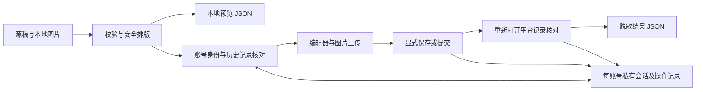

# 数据与操作流

最终输出给本地使用者或调用 CLI 的程序。两条主要使用流：先离线检查 Markdown；需要平台动作时，以指定别名保存草稿并核查，或显式提交正式发表并区分审核状态。

取：stdout 一个 JSON；可选 --result-file 新建 0600 文件，不覆盖旧文件；dry-run 可显式 --preview-file 导出内嵌图片的离线 HTML。平台成功需要列表记录 ID、状态、版本 2 正文结构摘要、链接摘要、图文结构位置和封面与当前操作匹配。

存：源 Markdown/图片只读。每个小写别名的 `meta.json` 关联头条数字 ID 与独立 Ego Profile，Cookie 由 Profile 管理。兼容路径继续使用 `browser-data`。各别名的操作记录与诊断独立保存，元信息与操作记录权限为 0600。正文按块结构比对，媒体记录完整 HTTPS URL 的 SHA-256。Ego 图文草稿另外核对图片描述、封面模式和顺序。已识别的头条媒体签名轮换时，比对同一资源路径及保留内容参数的摘要。旧版摘要不能自动升级为版本 2 证明。

进：所有操作由单次 CLI 调用触发。dry-run 不导入浏览器模块；登录、检查、退出及文章操作先取得账号目录之外的共享锁，再读取/改变会话。写路径先查平台列表；列表必须确认目标视图激活并完成加载，编辑前检查已有标题、正文和图片，提交前保存校验摘要，状态不明时只查询。回查成功保留原始 manifest，普通不确定结果与异常都保存诊断和阶段。崩溃残留锁须人工核查，不自动接管。

实际调用：`index → publish-article → article-input`。默认草稿通过 `ego-runtime → ego-worker → article-workflow → ego-draft-page` 执行。兼容路径使用 `article-page`。两个路径共用账号锁、操作签名和内容证明。Ego 的原生粘贴使用系统剪贴板，项目按机器串行执行写入任务。

UI 适配集中在 article-page / article-records。没有可靠选择器、完整列表、稳定身份或提交反馈时保守退出。平台异常只做一次回查，不重试提交；编辑器可能自动保存，所以编辑后的异常均可能是 unverified。

草稿队列入口为 `drafts add / run / overview / open`。任务私有保存在 `~/.toutiao-ops/draft-queue/jobs/`，引用源稿路径、排版签名和 Ego 账号绑定摘要。登记按账号、绑定及签名去重。执行持有队列锁，调用同一个 `publishArticle` 草稿入口，账号锁内再次核对绑定。恢复中断或结果不明的任务时，只执行现有草稿箱回查。`drafts open --sync` 在账号锁内通过 Ego 逐页读取已发布文章，缓存保存在 `publications/` 且与当前账号绑定关联。总览用任务和作品快照生成单文件 HTML，账号切换、过滤及分页在打开后的本地页面执行。
